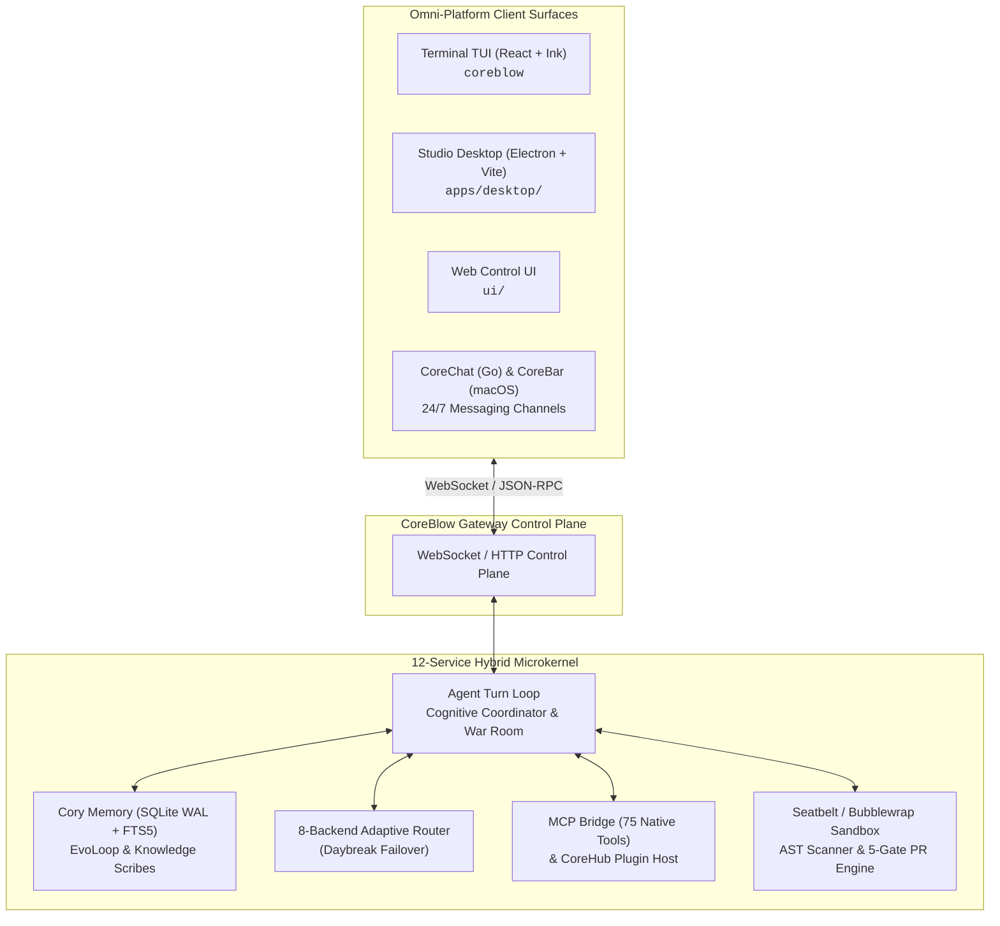

<p align="center">
  
</p>

<p align="center">
  <strong>One sovereign brain. Every surface.</strong><br>
  <em>The self-hosted AI Agent-OS &amp; Enterprise Gateway for terminal, desktop, web, and 24/7 channels — built with security by default.</em>
</p>

<p align="center">
  <a href="https://github.com/coreblow/coreblow/actions/workflows/ci.yml"></a>
  <a href="https://github.com/coreblow/coreblow/actions/workflows/security.yml"></a>
  <a href="https://www.npmjs.com/package/coreblow"></a>
  <a href="https://github.com/coreblow/coreblow/blob/main/LICENSE"></a>
  <a href="https://nodejs.org/">= 22.12" /></a>
</p>

<p align="center">
  <a href="https://coreblow.com">Website</a> •
  <a href="https://docs.coreblow.com/">Documentation</a> •
  <a href="https://coreblow.com/corehub">CoreHub Store</a> •
  <a href="https://docs.coreblow.com/cli">CLI Reference</a> •
  <a href="https://docs.coreblow.com/security">Security</a>
</p>

---

Start a task in your terminal, hand the exact session off to CoreBlow Studio Desktop without losing context, or let it keep running 24/7 over Telegram, Discord, Slack, and scheduled cron jobs. Everything connects to one local Gateway backed by SQLite memory and OS-level sandboxing — no cloud lock-in, no account wall, and no split state across devices.

Use any model you want — local Ollama, Anthropic, OpenAI, Google Gemini, OpenRouter, or your own OpenAI-compatible endpoint. Switch models mid-session with `/model`, or let the adaptive router fail over automatically when provider quotas tighten.

- **A real terminal UI, plus Desktop and Web** — Full React + Ink terminal interface (`coreblow`) with multiline editing, inline colored diffs, and approval prompts, seamlessly synchronized with CoreBlow Studio Desktop (`apps/desktop/`), Web Control UI, Go terminal companion (`corechat`), and macOS Menu Bar (`corebar`).
- **One memory that persists and learns** — Four-layer local memory (`USER.md`, `MEMORY.md`, `CONSTRAINTS.md`, daily journals) indexed with SQLite WAL + FTS5/BM25 (`< 2ms` recall). Completed tasks feed EvoLoop skill synthesis so your agent gets more useful without manual prompt rewrites.
- **Safe execution by default** — Loopback-only local Gateway by default, OS-level bash sandboxing (Apple Seatbelt on macOS, Bubblewrap on Linux), TypeScript AST skill security scanning, `per-channel-peer` DM isolation, and a SHA-256 tamper-evident audit journal.
- **Any model, automatic failover** — Route across 8 backends and 6 task tiers (`fast`, `deep`, `local`, `coding`, `vision`, `decision`) with Daybreak quota failover to fallback cloud models or local Ollama without dropping active turns.
- **Multi-agent delegation and PR gates** — Escalate complex tasks to specialist agents (`@coder`, `@researcher`, `@auditor`, `@verifier`, `@all`) on a Kanban DAG, backed by a 5-gate PR workflow (`typecheck`, `linter`, `unit_tests`, `secret_scan`, `forbidden_paths`).
- **24/7 channels, cron, and 75 MCP tools** — Built-in cron scheduler (`coreblow cron`), unified bot monitor (`coreblow bots`), and a live Model Context Protocol server (`coreblow mcp serve`) exposing 75 native tools over stdio and JSON-RPC.
- **Two-tier extensibility** — Install verified channel drivers and integrations on demand from CoreHub behind `coreblow/plugin-sdk`, or drop zero-dependency `SKILL.md` V2 cognitive workflows indexed in `< 2ms`.

---

## Quick Start

Requires **Node.js 22.12+**.

```bash
npm install -g coreblow
coreblow
```

Running `coreblow` for the first time launches an interactive setup wizard inside your terminal to pick your provider, model, and theme in under 30 seconds.

Other install options:

```bash
# Homebrew (macOS / Linux)
brew install coreblow/tap/coreblow

# Docker Compose (local containerized gateway)
git clone https://github.com/coreblow/coreblow.git && cd coreblow
docker compose up -d
```

---

## Daily Workflows

```bash
# Pipe diffs, logs, or files into headless mode (CI & Unix-friendly)
git diff | coreblow -p "Review these changes for security and edge cases" --output-format json

# Pick up right where you left off (SQLite FTS5 session store)
coreblow -c                           # continue the latest session in this folder
coreblow -r                           # fuzzy full-text search across past sessions

# Move from terminal to Desktop with the same live session
coreblow desktop --session latest

# Run the local Gateway, scheduled jobs, and messaging bots 24/7
coreblow gateway run                  # start the loopback gateway in the foreground
coreblow cron                         # manage scheduled background jobs
coreblow bots                         # monitor Telegram, Discord, Slack, WhatsApp, Signal

# Check Gateway latency and security posture
coreblow doctor --net                 # real RTT percentiles (min/median/p95/max ms)
coreblow security audit               # check config, permissions, and secret hygiene

# Launch the lightweight Go terminal client or serve 75 native MCP tools
coreblow chat --go
coreblow mcp serve
```

---

## Architecture

CoreBlow runs as a **12-service Hybrid OOP/DOP microkernel** inside a single local Gateway. Stateful services (registries, SQLite WAL, plugin sandboxes, War Room orchestration) stay isolated behind explicit OOP boundaries, while hot paths (prompt assembly, SSE streaming, model routing, skill distillation) run as pure data transforms.



<details>
<summary><strong>Monorepo Directory Layout</strong></summary>

<br>

| Directory | Responsibility | Tier |
| :--- | :--- | :--- |
| `src/gateway/` | Gateway server, WebSocket/HTTP control plane, and 12-service DI registry. | Kernel Host |
| `src/memory/` | Cory 4-layer memory, SQLite WAL + FTS5/BM25 index, Knowledge Scribes, and compaction. | Cognitive |
| `src/learning/` | EvoLoop skill synthesizer, DOP trajectory distiller, Wilson scoring, and skill locks. | Cognitive |
| `src/providers/` | 8-backend adaptive router, Daybreak quota failover, credential pool, and SSE streaming. | Routing |
| `src/agents/` | Single-brain Cognitive Coordinator, War Room Kanban DAG, and 5-gate PR workflow engine. | Orchestration |
| `src/mcp/` | Live Model Context Protocol bridge exposing 75 native tools over stdio and JSON-RPC. | Protocol |
| `src/plugins/` | Controlled plugin host, CoreHub App Store lifecycle, trust policies, and chat views. | Extensibility |
| `src/security/` | TypeScript AST skill scanner, execution approvals, secret redaction, and OS sandboxes. | Security |
| `src/tui/ink/` | Production React + Ink terminal UI (diffs, inline approvals, `/model`, `/pool`, `/rewind`, `/sandbox`). | Interface |
| `src/cli/` | Operator CLI (`onboard`, `doctor --net`, `chat --go`, `cron`, `bots`, `mcp`, `plugins`, `security`). | Interface |
| `apps/desktop/` | CoreBlow Studio Desktop (Electron + Vite + React with `--session` handoff and `sandbox: true`). | Desktop |
| `ui/` | Pre-built Web Control UI served directly by the Gateway. | Web |
| `extensions/` | Controlled workspace plugins managed via CoreHub. | Plugins |

</details>

<details>
<summary><strong>Companion Repositories &amp; Supply Chain (Fleet)</strong></summary>

<br>

All repositories under `github.com/coreblow` enforce 100% 40-character commit SHA-pinned GitHub Actions, automated CycloneDX SBOMs, and signed build provenance.

| Repository | Role |
| :--- | :--- |
| [`coreblow/corehub`](https://github.com/coreblow/corehub) | On-demand plugin App Store registry, Cloudflare Worker backend, and SHA-256 verified catalog |
| [`coreblow/corechat`](https://github.com/coreblow/corechat) | Standalone Go 1.22+ WebSocket / JSON-RPC terminal client (`coreblow chat --go`) |
| [`coreblow/corebar`](https://github.com/coreblow/corebar) | Native macOS SwiftUI Menu Bar status monitor for the local Gateway |
| [`coreblow/trust`](https://github.com/coreblow/trust) | OWASP Agentic AI threat model and automated policy evaluator |
| [`coreblow/corebox`](https://github.com/coreblow/corebox) | OS-level process isolation runner (Seatbelt, Bubblewrap, Docker) |
| [`coreblow/dolphin`](https://github.com/coreblow/dolphin) | Typed resumable workflow runner with atomic disk checkpoints |
| [`coreblow/corebench`](https://github.com/coreblow/corebench) &amp; [`coreblow-rtt`](https://github.com/coreblow/coreblow-rtt) | Gateway latency, TTFT/RTT network profiling, and benchmark harnesses |
| [`coreblow/homebrew-tap`](https://github.com/coreblow/homebrew-tap), [`nix-coreblow`](https://github.com/coreblow/nix-coreblow), [`coreblow-ansible`](https://github.com/coreblow/coreblow-ansible) | Native packaging and hardened server provisioning |

</details>

---

## Operator Quick Reference

```bash
# Setup & configuration
coreblow onboard                  # Guided interactive setup for models, channels, and skills
coreblow configure                # Edit gateway, provider, and credential settings

# Gateway operations
coreblow gateway run              # Start the local gateway in the foreground
coreblow gateway status           # Check daemon status and socket reachability
coreblow health --json            # Fetch structured health output

# Diagnostics & companions
coreblow doctor --net             # Measure Gateway RTT latency (min/median/p95/max ms)
coreblow chat --go                # Launch the compiled Go terminal companion (corechat)
coreblow desktop --session <id>   # Open an active session in CoreBlow Studio Desktop

# Automations, protocols & security
coreblow cron                     # Manage 24/7 scheduled background tasks
coreblow bots                     # Monitor connected messaging bots
coreblow mcp serve                # Serve 75 native tools via Model Context Protocol
coreblow security audit           # Audit permissions, secrets, and sandbox posture
```

---

## Development & Contributing

Requires **Node.js 22.12+** and **pnpm 10+**.

```bash
git clone https://github.com/coreblow/coreblow.git
cd coreblow
pnpm install
pnpm check       # oxlint + tsgo + MCP budget + SDK boundary + security checks
pnpm test        # vitest suite
pnpm build       # Control UI + runtime bundles + plugin-sdk declarations
```

Fleet companion scripts (automatically resolves binary on `$PATH` or local companion checkout):

```bash
pnpm corebar:dev           # Run macOS menu-bar companion
pnpm chat:go               # Run Go terminal companion
pnpm trust:eval --help     # Run OWASP Agentic AI policy evaluator
pnpm rtt:probe             # Probe Gateway TTFT / RTT latency
pnpm bench:run             # Run Gateway benchmark suite
```

See [CONTRIBUTING.md](https://github.com/coreblow/coreblow/blob/main/CONTRIBUTING.md) for contribution guidelines, code style standards, and verification workflows.

Further reading:
- [Architecture Blueprint](https://github.com/coreblow/coreblow/blob/main/docs/ARCHITECTURE.md)
- [Ecosystem Contract Map](https://github.com/coreblow/coreblow/blob/main/docs/ECOSYSTEM_MAP.md)
- [Product Requirements](https://github.com/coreblow/coreblow/blob/main/docs/PRD.md)
- [Releases & Upcoming Work](https://github.com/coreblow/coreblow/releases)
- [Discussions](https://github.com/coreblow/coreblow/discussions)
- [Issues](https://github.com/coreblow/coreblow/issues)
- [Documentation Portal](https://docs.coreblow.com/)

---

## License

CoreBlow is open-source software licensed under the [MIT License](https://github.com/coreblow/coreblow/blob/main/LICENSE).
Copyright © 2026 Febrinanda and CoreBlow contributors.
