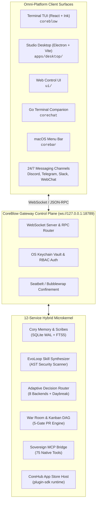

<p align="center">
  
</p>

<h1 align="center">CoreBlow</h1>

<p align="center">
  <strong>The Sovereign, Self-Hosted AI Agent-OS & Enterprise Gateway</strong><br>
  <em>One local brain. 75 native MCP tools. Persistent SQLite memory. Multi-agent War Room. Terminal, Desktop, Web, and 24/7 messaging channels — all under your own infrastructure.</em>
</p>

<p align="center">
  <a href="https://www.npmjs.com/package/coreblow"></a>
  <a href="LICENSE"></a>
  <a href="https://nodejs.org/">= 22.12" /></a>
  <a href="https://docs.coreblow.com/mcp"></a>
  <a href="docs/ARCHITECTURE.md"></a>
</p>

<p align="center">
  <a href="https://coreblow.com">Website</a> •
  <a href="https://docs.coreblow.com/">Documentation</a> •
  <a href="https://coreblow.com/corehub">CoreHub Store</a> •
  <a href="https://docs.coreblow.com/cli">CLI Reference</a> •
  <a href="https://docs.coreblow.com/security">Security</a>
</p>

---

## ⚡ Try CoreBlow in 30 Seconds

Install the global CLI binary and launch your sovereign agent session immediately:

```bash
# 1. Install globally via npm (Node.js 22.12+ required)
npm install -g coreblow

# 2. Launch interactive React + Ink TUI (with automatic first-run setup wizard)
coreblow
```

> **Prefer Homebrew or Docker?**
> ```bash
> # macOS / Linux via Homebrew
> brew install coreblow/tap/coreblow
>
> # Docker Compose (local containerized gateway on port 3000)
> git clone https://github.com/coreblow/coreblow.git && cd coreblow
> docker compose up -d
> ```

---

## 🚀 What You Can Do Right Away

CoreBlow is built for Unix composability, real developer workflows, and immediate terminal productivity:

```bash
# 1. Headless Unix Pipe with Structured JSON Output
git diff | coreblow -p "Review these changes for security and edge cases" --output-format json

# 2. Instant Session Resume via SQLite FTS5 Full-Text Search
coreblow -c                   # Seamlessly continue the latest workspace session
coreblow -r                   # Open interactive fuzzy session picker (< 2ms recall)

# 3. Studio Desktop Handoff
coreblow desktop --session latest  # Launch CoreBlow Studio Desktop with synchronized state

# 4. Run 24/7 Gateway Daemon, Scheduled Cron & Messaging Bots
coreblow gateway run          # Foreground WebSocket Gateway on loopback ws://127.0.0.1:18789
coreblow cron                 # Inspect and manage persistent agent background automations
coreblow bots                 # Monitor connected 24/7 channel bots (Telegram, Discord, Slack, etc.)

# 5. Network Latency & Security Diagnostics
coreblow doctor --net         # Real RTT latency probe (min/median/p95/max ms) against gateway
coreblow security audit       # Scan local config, AST permissions, and runtime credentials

# 6. Live Model Context Protocol (MCP) Tool Server
coreblow mcp serve            # Expose 75 native tools via stdio / JSON-RPC to any MCP client
```

---

## 💎 Why Engineers Switch to CoreBlow

| Pillar | Engineering Reality | What You Get |
| :--- | :--- | :--- |
| **One Brain, Every Surface** | Single Gateway authority at `ws://127.0.0.1:18789` | Terminal TUI (`src/tui/ink/`), Studio Desktop (`apps/desktop/`), Web Control UI (`ui/`), Go terminal companion (`corechat`), native macOS menu bar (`corebar`), and 24/7 chat channels share identical state and memory. |
| **Persistent Memory That Learns** | SQLite WAL + BM25 FTS5 indexing with `< 2ms` recall | Cory 4-Layer Memory (`USER.md`, `MEMORY.md`, `CONSTRAINTS.md`, daily journals), Knowledge Scribes, entity graphs, and EvoLoop closed-loop skill synthesis (`src/learning/`) with Bayesian Wilson scoring. |
| **8-Backend Adaptive Router** | Unified streaming interface across local and cloud LLMs | Zero vendor lock-in: route dynamically across local Ollama, Anthropic, OpenAI, Google Gemini, OpenRouter, and custom gateways across 6 task tiers with Daybreak quota window failover. |
| **Multi-Agent War Room** | Deterministic Kanban DAG coordinator | Assemble specialized agents (`@coder`, `@researcher`, `@auditor`, `@verifier`, `@all`) with round-robin consensus, dispute arbitration, and automated 5-gate PR verification workflows (`src/agents/`). |
| **Security-First by Default** | Loopback isolation & OS-level confinement | Strict `127.0.0.1` default bind, Apple Seatbelt / Linux Bubblewrap process isolation, TypeScript AST skill scanner, `per-channel-peer` DM isolation, and SHA-256 tamper-evident audit journal. |
| **Two-Tier Extensibility** | Verified app store + zero-overhead skills | **Tier A:** Enterprise plugins backed by the type-safe `coreblow/plugin-sdk`. **Tier B:** Zero-dependency `SKILL.md` V2 cognitive instructions discovered instantly without bundle recompilation. |

---

## 🏛️ Architecture at a Glance

CoreBlow is architected as an enterprise-grade **12-Service Hybrid OOP/DOP Microkernel**: OOP enforces strict lifecycle ownership, connection pools, and service registries, while Data-Oriented Programming (DOP) delivers zero-copy transforms and sub-millisecond cold boot on hot inference paths.



<details>
<summary><strong>📁 Monorepo Directory Layout & Subsystem Responsibilities</strong></summary>

<br>

| Directory | Subsystem Responsibility | Architectural Tier |
| :--- | :--- | :--- |
| `src/gateway/` | WebSocket server, RPC message router, HTTP API, and 12-Service DI container (`MicrokernelRegistryService`). | Kernel Host |
| `src/memory/` | Cory 4-layer semantic memory, entity graph, Knowledge Scribes, browsable wiki, and compaction (`CoryMemoryService`). | Cognitive Subsystem |
| `src/learning/` | EvoLoop Skill Synthesizer, DOP skill distiller, and per-skill lock registry (`SkillSynthesizerService`). | Cognitive Subsystem |
| `src/providers/` | 8-Backend Adaptive Decision Router, Daybreak quota failover, and streaming model adapters (`DecisionRouterService`). | Inference Routing |
| `src/agents/` | Single-agent turn coordinator, War Room multi-agent DAG, and autonomous 5-gate PR engine (`WarRoomService`). | Agent Orchestration |
| `src/mcp/` | Sovereign Model Context Protocol bridge exposing 75 native tools over stdio and JSON-RPC (`SovereignMcpBridgeService`). | Protocol & Tools |
| `src/plugins/` | CoreHub plugin lifecycle, permission sandboxing, and interactive chat views (`AppStoreRuntimeService`). | Extensibility Host |
| `src/security/` | TypeScript AST skill scanner, execution approvals, loopback guards, and sandbox isolation profiles. | Governance & Trust |
| `src/tui/ink/` | Production Terminal User Interface built with React, Ink, and syntax-highlighted streaming widgets. | User Interface |
| `src/cli/` | Command-line interface definitions, automated onboarding wizard, and diagnostic tools. | User Interface |
| `apps/desktop/` | CoreBlow Studio Desktop (Electron + Vite + React with CLI `--session` handoff and secure sandbox). | Native Clients |
| `ui/` | Lightweight Web Control UI dashboard served directly by the Gateway. | Native Clients |
| `extensions/` | Controlled workspace plugin packages managed via CoreHub and published to npm. | Ecosystem Layer |

</details>

---

## 🌐 The Federated CoreBlow Fleet

CoreBlow maintains a federated constellation of specialized, high-performance companion tools and deployment packages:

| Repository | Purpose & Capabilities | Ecosystem Role |
| :--- | :--- | :--- |
| [**corehub**](https://github.com/coreblow/corehub) | Verified plugin storefront, cryptographic package signing, and catalog registry. | App Store Layer |
| [**corechat**](https://github.com/coreblow/corechat) | Ultra-lightweight, standalone Go companion with real-time WebSocket streaming. | Terminal Companion |
| [**corebar**](https://github.com/coreblow/corebar) | Native macOS menu bar status monitor and quick-prompt companion (Swift). | Desktop Integration |
| [**trust**](https://github.com/coreblow/trust) | OWASP Top 10 for Agentic AI threat policy evaluator and safety bundle. | Security Governance |
| [**corebox**](https://github.com/coreblow/corebox) | OS-level clean-room sandbox runner (Seatbelt, Bubblewrap, Docker confinement). | Process Confinement |
| [**dolphin**](https://github.com/coreblow/dolphin) | Typed resumable workflow runner shell for complex multi-step pipelines. | Workflow Execution |
| [**corebench**](https://github.com/coreblow/corebench) | Full-stack performance, latency, and throughput benchmark harness. | Benchmarks & QA |
| [**coreblow-rtt**](https://github.com/coreblow/coreblow-rtt) | Streaming Time-to-First-Token (TTFT) and Round-Trip-Time (RTT) profiler. | Diagnostics |
| [**homebrew-tap**](https://github.com/coreblow/homebrew-tap) | Official Homebrew formulas for CoreBlow and native fleet binaries. | Package Distribution |
| [**nix-coreblow**](https://github.com/coreblow/nix-coreblow) | Nix flake and package declarations for reproducible, declarative environments. | Nix Ecosystem |
| [**coreblow-ansible**](https://github.com/coreblow/coreblow-ansible) | Production deployment playbooks, systemd unit templates, and multi-node provisioning. | Infrastructure as Code |

> **Supply-Chain Integrity:** All CoreBlow fleet repositories enforce 100% 40-character commit SHA-pinned GitHub Actions, automated CycloneDX Software Bills of Materials (SBOMs), and cryptographically signed build provenance attestations.

---

## 🛠️ Operator Quick Reference

```bash
# ─── Configuration & Onboarding ──────────────────────────────────
coreblow onboard               # Guided interactive setup for models, channels, and skills
coreblow configure             # Fast configuration editor for gateway and credentials

# ─── Gateway Service Operations ──────────────────────────────────
coreblow gateway run           # Start the gateway in the foreground
coreblow gateway status        # Inspect daemon status and socket reachability
coreblow health --json         # Fetch real-time health telemetry in JSON format

# ─── Diagnostics & Companion Handoff ────────────────────────────
coreblow doctor --net          # Measure Gateway round-trip latency (min/median/p95/max)
coreblow chat --go             # Launch compiled Go terminal companion (corechat)
coreblow desktop --session <id># Open CoreBlow Studio Desktop for an active session

# ─── 24/7 Automations & Protocols ────────────────────────────────
coreblow cron                  # Inspect and manage scheduled background cron tasks
coreblow bots                  # Monitor 24/7 background channel bots
coreblow mcp serve             # Run Model Context Protocol server (75 native tools)
coreblow security audit        # Run comprehensive local security and credential audit
```

---

## 💻 Development & Contributing

Prerequisites: Node.js 22.12+, pnpm 10+, and Bun (or native toolchain for companions).

```bash
# 1. Clone the repository and install workspace dependencies
git clone https://github.com/coreblow/coreblow.git
cd coreblow
pnpm install

# 2. Run local verification gates
pnpm check                     # Run Oxlint and type-check verification
pnpm test                      # Run Vitest test suite
pnpm build                     # Build Control UI and runtime bundle

# 3. Fleet companion development scripts
pnpm corebar:dev               # Run macOS Swift menu-bar app in development
pnpm chat:go                   # Run Go corechat companion via go run
pnpm trust:eval --help         # Run OWASP Agentic AI trust policy evaluation
pnpm rtt:probe                 # Probe live TTFT/RTT latency against the local gateway
pnpm bench:run                 # Execute full-stack performance benchmarks
```

For deeper architectural specifications and development guides:
- [Architecture Blueprint](docs/ARCHITECTURE.md)
- [Ecosystem Contract Map](docs/ECOSYSTEM_MAP.md)
- [Product Requirements Document](docs/PRD.md)
- [Phased Release Roadmap](docs/PHASE5_TO_7_ROADMAP.md)
- [Online Documentation Portal](https://docs.coreblow.com/)

---

## 📄 License

CoreBlow is open-source software licensed under the [MIT License](LICENSE).
Copyright © 2026 Febrinanda and CoreBlow contributors.
