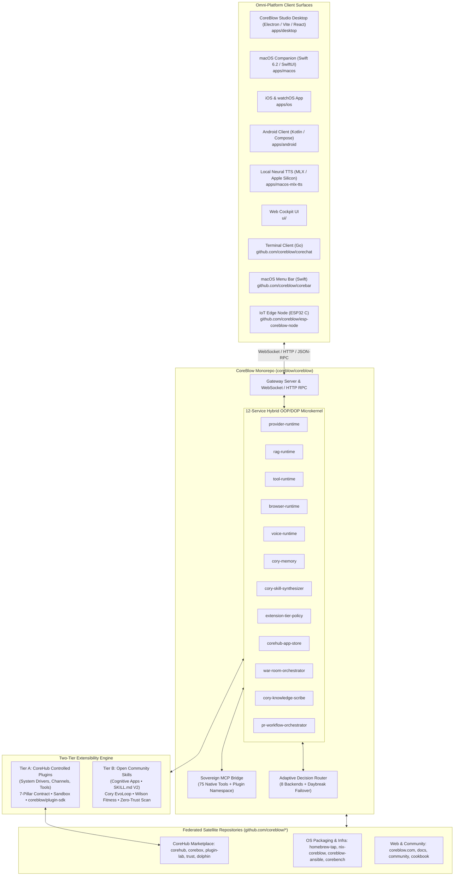
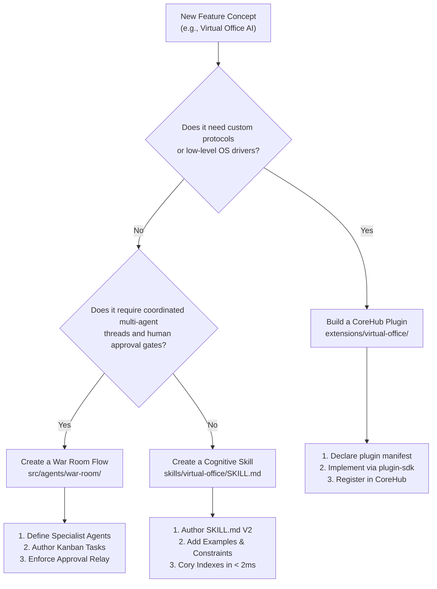

# CoreBlow Sovereign Ecosystem & Extensibility Blueprint
> **Universal Architecture Map, Omni-Platform Native Clients, and the Two-Tier Extensibility Model**

---

## 1. Executive Ecosystem Topology

CoreBlow is designed as an enterprise-grade, self-hosted Sovereign Agent-OS. Rather than an unwieldy, monolithic bundle that accumulates dependency bloat and crashes on unvetted third-party code, CoreBlow separates concerns into a **12-Service Native Microkernel Monorepo (`coreblow/coreblow`)**, **Omni-Platform Native Client Surfaces**, and a **Federated Fleet of 25 Specialized Repositories** under the `coreblow` GitHub organization.



---

## 2. Monorepo Subsystem Map (`coreblow/coreblow`)

The primary repository is structured strictly around clear architectural boundaries, separating stateful service ownership (OOP) from pure data contracts and high-throughput transformations (DOP):

| Monorepo Path | Responsibility & Architectural Role | Core Technologies / Standards |
|---|---|---|
| `src/gateway/` | Gateway server, Microkernel `ServiceRegistry` initialization, WebSocket control plane, HTTP REST routes, and CoreHub endpoint dispatch. | Node.js HTTP/WS, Microkernel OOP |
| `src/memory/` | **Cory 4-Layer Memory Engine**: SQLite WAL + FTS5/BM25 associative memory (`cory.ts`), Scribe notes, browsable memory wiki, and zero-stall prepared compaction (`knowledge-scribe.ts`). | SQLite WAL, BM25, Markdown Wiki |
| `src/learning/` | **Cory EvoLoop**: Closed-loop skill synthesizer, trajectory distiller, Bayesian Wilson score fitness ranking ($z=1.28$), and per-skill immutability locks. | Pure DOP, Bayesian Statistics |
| `src/providers/` | **Adaptive Decision Router**: 6-tier model classifier (`fast`, `deep`, `local`, `coding`, `vision`, `decision`) and Daybreak subscription/quota window failover. | DOP Transforms, Stream Parsers |
| `src/agents/war-room/` | **Multi-Agent War Room**: Lead Agent orchestration, sibling thread forking, child approval relays, and Kanban DAG state machine. | Event Bus, DAG Engine |
| `src/agents/pr-workflow/` | **Autonomous PR Workflow Engine**: Pre-flight gates (`typecheck`, `linter`, `unit_tests`, `secret_scan`, `forbidden_paths`), PR blueprint compiler, and operator approval gate. | Git Diff Analysis, AST Guards |
| `src/plugins/` | **CoreHub Plugin Host & Tier Policy**: 7-Pillar App Store contract runtime, permission grants, capability manifests, and sandboxed plugin lifecycles. | Contract Verification, Isolation |
| `src/plugins/chat-views/`| **Interactive Plugin Chat Views**: Multi-surface renderers (`cockpit_html`, `markdown_card`, `channel_blocks`) and strict XSS sanitization. | HTML Sanitizer, UI Cards |
| `src/tts/` | **Sovereign Local Voice Telemetry**: Real-Time Factor (RTF) calculations and Apple Silicon Neural Engine voice telemetry certification ($\text{RTF} \le 0.4$). | Audio Latency Profiling |
| `src/migration/` | **Universal Workspace Profile Importer**: Multi-format profile import (`coreblow-bundle`, `standard-agents-md`, sovereign and standard workspace formats) with secret redaction. | Workspace Parsing, Secret Sanitizer |
| `src/infra/release/` | **Sovereign Release Certifier**: 5-gate production GA readiness auditor, 12-service verification, and deterministic SHA-256 manifest compiler. | Cryptographic Manifests |
| `src/mcp/` | **Sovereign MCP Bridge**: Model Context Protocol JSON-RPC & Stdio transport exposing 75 built-in native tools, dynamic plugin MCP tools with collision namespacing (`${pluginId}__${toolName}`), and `notifications/coreblow/*` wire protocol. | MCP 2024-11-05 Specification |
| `src/plugin-sdk/` | **Public Plugin SDK**: Stable public barrels for providers, tools, memory, channels, and agents. | Public API Contracts |
| `apps/desktop/` | **CoreBlow Studio Desktop**: Electron + Vite + React desktop companion with CLI `--session` / `COREBLOW_SESSION_ID` handoff, `webPreferences.sandbox: true`, and screen capture consent guard. | Electron, Vite, React, IPC Security |
| `apps/macos/` | Native macOS menu bar and desktop companion app written in modern Swift 6.2 and SwiftUI. | Swift 6.2, SwiftUI, AppKit |
| `apps/macos-mlx-tts/` | Native Apple Silicon Neural Engine voice synthesizer using Apple MLX framework. | Swift, MLX, Apple Accelerate |
| `apps/ios/` | Native iOS and watchOS companion app with interactive widgets, share extensions, and watch complications. | Swift 6.2, SwiftUI, WidgetKit |
| `apps/android/` | Native Android companion client with Jetpack Compose UI and background service management. | Kotlin, Jetpack Compose, Gradle |
| `apps/shared/` | Shared cross-platform Swift packages (`CoreBlowKit`, `CoreBlowChatUI`, `CoreBlowProtocol`). | Swift Package Manager |
| `apps/swabble/` | Low-level acoustic and hotword detection framework for continuous listening. | Swift, AVFoundation |
| `ui/` | **Web Cockpit UI**: Modern operator dashboard, CoreHub storefront, memory inspector, and war room kanban board. | TypeScript, Web Components, Vite |
| `extensions/` | Bundled workspace plugin packages (channel drivers, web search, media pipelines, etc.). | Isolated Workspace Packages |

---

## 3. The 26 Federated Organization Repositories

The broader CoreBlow ecosystem spans 26 repositories grouped into 5 strategic functional tiers:

```
┌──────────────────────────────────────────────────────────────────────────────────────────────────┐
│                                 COREBLOW 26-REPOSITORY FLEET                                     │
└──────────────────────────────────────────────────────────────────────────────────────────────────┘
  [Tier 1: Core OS & Native Companion Apps]
   • coreblow/coreblow (Induk) — Core Agent-OS Monorepo, 12-Service Microkernel & Native Mobile Apps
   • apps/desktop              — CoreBlow Studio Desktop (Electron + Vite + React with CLI --session handoff, sandbox, screen consent)
   • coreblow/corebar          — macOS Native Menu Bar App (Swift 6.2 / SwiftUI)
   • coreblow/corechat         — Ultra-fast Terminal Client in Pure Go 1.22+
   • coreblow/corekit          — Shared Go Toolkit & Socket Transport for CLI Tools
   • coreblow/coredex          — Cross-Platform Contact Book & Identity Directory in Go

  [Tier 2: Lightweight Nodes & Hardware Edges]
   • coreblow/coreblow-windows-node — Windows Service Companion in C# (.NET 8) with DPAPI Keyring
   • coreblow/esp-coreblow-node     — Embedded C Microcontroller Firmware for ESP32 IoT Nodes
   • coreblow/dolphin               — Typed Resumable Workflow Shell & Checkpoint Engine
   • coreblow/corebox               — Clean-Room Process Isolation & Ephemeral Container Runner

  [Tier 3: CoreHub App Store, Marketplace & Security]
   • coreblow/corehub    — App Store Registry, Cloudflare Worker backend, D1 SQLite & Storefront UI
   • coreblow/trust      — Trust & Security Authority, Threat Models, and OWASP Agentic AI Policies
   • coreblow/plugin-lab — Isolated Verification Testbed for Staging Third-Party Plugins

  [Tier 4: Packaging, Provisioning & Benchmarking]
   • coreblow/homebrew-tap       — Official macOS / Linux Homebrew Formula (`brew install coreblow/tap`)
   • coreblow/nix-coreblow       — Deterministic Nix Flake Distribution (`flake.nix`)
   • coreblow/nix-coreblow-tools — Pre-configured Nix Development Shells
   • coreblow/coreblow-ansible   — Automated Server Hardening & Distributed Fleet Playbooks
   • coreblow/corebench          — High-concurrency 1,000-turn Benchmark Harness
   • coreblow/coreblow-rtt       — Network Round-Trip Time & Time-To-First-Token Latency Profiler
   • coreblow/coregrit-reports   — Continuous Long-Term Agent Reliability Metrics
   • coreblow/corewatch          — Real-time Gateway Health Watcher Daemon
   • coreblow/corewatch-state    — Distributed Watcher State Storage & Synchronization
   • coreblow/corepatch          — Zero-Downtime Hotpatching Utility for Production Nodes

  [Tier 5: Documentation, Portal & Community]
   • coreblow/coreblow.com — Official Web Portal & Installer (`curl -sL https://coreblow.com/install.sh`)
   • coreblow/docs         — Official Public Documentation Site (`docs.coreblow.com`)
   • coreblow/community    — Community Governance, Contribution RFCs, and Developer Hub
   • coreblow/cookbook     — Verified Recipes, Production Patterns, and Multi-Agent Templates
```

---

## 4. The Two-Tier Extensibility Model

Why does CoreBlow stay sub-millisecond, crash-proof, and secure while other agent platforms degrade into unstable dependency conflicts? The secret is CoreBlow's **Two-Tier Extensibility Model**:

```
                                  ┌───────────────────────────────┐
                                  │   OPERATOR REQUEST / INTENT   │
                                  └───────────────┬───────────────┘
                                                  │
                                                  ▼
                        Does the capability require binary native I/O,
                        hardware access, or external network protocol daemons?
                                        /                   \
                                      YES                    NO
                                      /                        \
                                     ▼                          ▼
                         [TIER A: COREHUB PLUGIN]       [TIER B: COMMUNITY SKILL]
                         • Heavy / System Driver        • Pure Cognitive Capability
                         • Controlled Sandbox           • Zero-Dependency Markdown
                         • 7-Pillar App Store Contract  • Cory EvoLoop Self-Learning
                         • Dynamic Hot-Loading          • Sub-millisecond BM25 Recall
                         • isolated behind plugin-sdk   • Bayesian Wilson Ranking
```

### Tier A: Official CoreHub Plugins (`corehub:<pkg>`) — System Drivers
- **When to use:** Deep system integrations, new messaging channels (e.g. WhatsApp, Discord, Slack), custom vector database drivers, or hardware I/O.
- **Safety guarantees:**
  1. Isolated behind `coreblow/plugin-sdk/*` public interfaces.
  2. Subject to the **7-Pillar App Store Contract**: explicit capability declarations, cryptographic manifests, dry-run installations, and non-destructive rollbacks.
  3. Governed by the **Extension Tier Policy**: Untrusted or community plugins run strictly in sandboxed worker processes and cannot mutate core Microkernel state.
  4. Installed on-demand into `extensions/<id>` or via npm packages without requiring gateway rebuilds.

### Tier B: Open Community Skills (`SKILL.md` V2) — Cognitive Apps
- **When to use:** Cognitive workflows, domain-specific prompt blueprints, code generation guidelines, API consumption instructions, or automated reasoning chains.
- **Safety guarantees:**
  1. **Zero Runtime Dependencies:** Stored as structured, human-readable `SKILL.md` documents.
  2. **Sub-Millisecond Indexed Recall:** Indexed in SQLite WAL with BM25 full-text indexing, recalled into agent context in `< 2ms` without bloated vector embeddings.
  3. **Cory EvoLoop Synthesis:** The system can synthesize new skills autonomously from successful turns (`src/learning/dop-skill-distiller.ts`), score them via Bayesian Wilson statistics ($z=1.28$), and promote them from `candidate` to `verified_active`.
  4. **Immutable Locks (`locked: true`):** Operators can lock critical corporate skills so autonomous agents cannot regress or overwrite them.
  5. **3-Gate Zero-Trust Security Scanner:** Prohibits shell injection patterns, dangerous privilege escalation, and raw secret storage.

---

## 5. Developer Guide: How to Add New Capabilities

### Scenario: Adding a "Virtual Office AI" or Custom Assistant Feature

When you or an enterprise developer want to add a major new capability—such as a **Virtual Office AI** that tracks desk availability, schedules meetings, and answers workplace questions—follow this decision tree:



### Approach 1: The Cognitive Skill Approach (Fastest, Cleanest, 0 Overhead)
If your Virtual Office AI relies on existing tools (curl, Google Calendar API via REST, database queries, or browser automation), build it as a **Tier B Skill**:

1. Create a directory `skills/virtual-office/SKILL.md`:
   ```markdown
   ---
   name: virtual-office
   description: Desk booking, meeting room scheduling, and workplace facility assistant.
   version: 1.0.0
   locked: true
   tags: [office, facilities, scheduling]
   ---

   # Virtual Office Assistant Skill

   ## Capabilities
   - Book desks and meeting rooms using corporate facility APIs.
   - Summarize daily office occupancy and colleague locations.

   ## Guardrails & Constraints
   - Never book more than 5 consecutive business days without manager approval.
   - Always confirm time zone and office site before finalizing reservations.
   ```
2. CoreBlow's **Cory Memory & Knowledge Scribe** automatically indexes this file on startup. It is searchable in `< 2ms` and consumes zero background RAM until recalled.

### Approach 2: The CoreHub Plugin Approach (For Deep I/O & Drivers)
If your Virtual Office AI requires a custom sensor websocket, Bluetooth beacon scanning, or dedicated hardware:

1. Scaffold an extension package in `extensions/virtual-office/`:
   ```
   extensions/virtual-office/
   ├── package.json
   ├── src/
   │   ├── index.ts
   │   └── driver.ts
   └── coreblow.plugin.json
   ```
2. Import exclusively from the public SDK:
   ```typescript
   import type { CoreBlowPluginDefinition } from "coreblow/plugin-sdk/plugins";
   ```
3. Register the capability in `coreblow.plugin.json`. The Microkernel will dynamically mount it with zero performance penalty on standard turns.

### Approach 3: The Multi-Agent War Room Approach (For High-Stakes Operations)
If the feature coordinates multiple autonomous bots with strict operator sign-offs (e.g. Facilities Bot + Security Bot + Finance Approver):
- Use the **Multi-Agent War Room Engine** (`src/agents/war-room/`):
  1. The **Lead Agent** breaks down the request into a Kanban DAG.
  2. Sibling threads execute in parallel.
  3. Sensitive actions trigger an `approval_prompt` view directly in chat.
  4. Once approved, the PR Workflow Engine verifies changes before committing.

---

## 6. CoreBlow v2.1.x Architecture & Runtime Capabilities

CoreBlow v2.1.x introduces core architectural additions that harden the microkernel for enterprise autonomy:

1. **Headless Execution (`coreblow -p "<prompt>"`):** Direct non-interactive pipeline execution delivering structured results straight to stdout for scripting and CI automation without requiring interactive TTY allocation.
2. **Session Continuation & Interactive Resumption (`coreblow -c` / `coreblow -r [id]`):** Seamless resumption of the workspace's latest session or interactive fuzzy selection across active and archived conversational threads.
3. **SQLite WAL + FTS5 Session & Memory Engine:** Robust multi-process SQLite session store operating in Write-Ahead Logging (WAL) mode with BM25 full-text search indexing across conversational turns and Cory memory notes.
4. **24/7 Cron Orchestration (`coreblow cron`):** Native gateway daemon scheduler supporting persistent cron jobs, isolated agent turns, and payload fallbacks with guaranteed execution boundaries.
5. **Default Cross-Channel Isolation (`dmScope: "per-channel-peer"`):** Direct messaging contexts enforce per-channel peer scoping by default, preventing state leakage across mixed channel boundaries.
6. **TypeScript AST-Based Skill Security Scanner (`src/security/skill-scanner.ts`):** Pre-execution AST security validation enforcing zero-trust analysis against shell injection, privilege escalation, and credential exposure.
7. **8-Backend Sovereign Execution Router:** Dynamic runtime classifier routing across fast, deep, local, coding, vision, decision, embedding, and speech execution backends with Daybreak subscription and quota window failover.

---

## 7. Summary: Architectural Invariants

1. **Sub-Millisecond Cold Starts:** The 12 Microkernel services initialize deterministically without dynamic runtime compilation overhead.
2. **Crash-Proof Isolation:** Community plugins cannot crash the gateway; skills are pure text blueprints executed within standard turn boundaries.
3. **100% Brand Sovereignty:** Independent, original architecture built from first principles with zero reliance on competitor platforms.
4. **Offline & Edge Capable:** Full functionality runs on local silicon (Apple Silicon MLX, local Ollama, on-device SQLite) with zero telemetry phone-home requirements.
