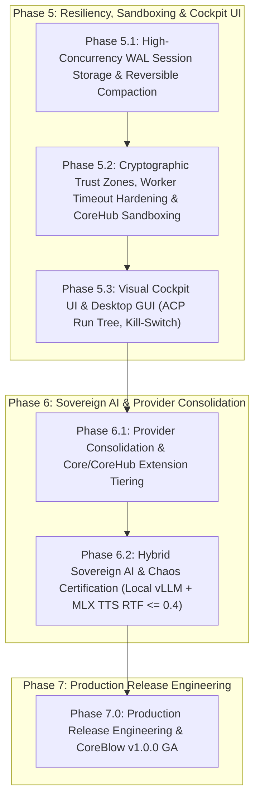

# CoreBlow Phase 5–7 Sequential Master Roadmap

**Document Version:** 1.5.0 (v1.0.0 GA Certified) 
**Status:** 100% COMPLETE / Production GA Baseline 
**Completed Milestones:** Phase 5.1 (`7a4ddf7a0`), Phase 5.2 (`b289d9f62`), Phase 5.3 (`e5959fbe2`), Phase 6.1 (`b1f0de948`), Phase 6.2 (`3c128f07f`), Phase 7.0 
**Baseline Parity:** 100% Parity Maintained 
**Product Canonical URLs:** [https://coreblow.com](https://coreblow.com) | [https://github.com/coreblow](https://github.com/coreblow) 
**Documentation Portal:** [https://docs.coreblow.com](https://docs.coreblow.com)

---

## 1. Executive Overview & Sequential Execution Strategy

With Phase 4 functional parity certified at 100% across all 4,907 shared source files, 2,832 test suites, and 0 missing files or export gaps, CoreBlow enters its **Hardening, Sovereign Intelligence, and Production Release** lifecycle.

This roadmap establishes a strict **Bottom-Up Sequential Architecture**:
Each layer provides the mathematical invariants and runtime guarantees required by the layers above it.

---

## 2. Phase 5: Resiliency, Trust Boundaries & Cockpit Interface

### Phase 5.1: High-Concurrency WAL Session Storage & Reversible Compaction (COMPLETE)
**Target Surface:** `src/infra/storage/`, `src/agents/compaction/`

- **High-Concurrency WAL Session Ledger (`src/infra/storage/wal-session-ledger.ts`):**
  - High-throughput Write-Ahead Logging (WAL) event journal replacing raw file-locking JSONL writes.
  - Supports non-blocking append and atomic batch transactions for 50+ concurrent ACP subagents recording turns, tool executions, and telemetry.
  - Implements the `ServiceRegistry` lifecycle contract (`start()`, `stop()`, `health()`).
  - Crash recovery replay mechanism with checksum verification (`crc32`/`sha256`).
- **Reversible Compaction & Immutable Governance Tags (`src/agents/compaction/reversible-compaction-ledger.ts`):**
  - Mathematical non-evictability of system safety and trust-zone directives tagged with `immutable: true` (mitigating OWASP ASI06 / ASI07).
  - Two-way `content_hash` pointer resolution to `~/.coreblow/scratchpad/` so compacted tool outputs and context blocks can be inspected, audited, or losslessly re-expanded on demand.
  - Compaction audit ledger maintaining history of all summarization cycles with token metrics.

### Phase 5.2: Cryptographic Trust Zones, Worker Timeout Hardening & CoreHub Sandboxing (COMPLETE)
**Target Surface:** `src/security/`, `src/acp/`, `src/plugins/sandbox/`

- **Cryptographic Trust Zones (Zone 0, Zone 1, Zone 2):**
  - **Zone 0 (System Core / Operator):** Full host and supervisor capabilities, authenticated via local unix socket or hardware bearer token.
  - **Zone 1 (Authenticated Channel Users):** Paired and allowlisted channel users; scoped to workspace directory and read/write agent operations.
  - **Zone 2 (Untrusted Public Ingress):** Webhooks, public Discord/Telegram channels; strictly read-only tools, sandboxed prompt evaluation, zero shell execution.
- **ACP Worker-Thread Timeout Hardening:**
  - Enforce a hard 120s execution timeout ceiling across subagent ACP worker threads to neutralize runaway ReAct execution loops (mitigating CVE-2026-84288 / OWASP ASI08).
  - Configurable per-task timeout budgets with deterministic cleanup of orphaned child processes.
- **CoreHub Capability Sandboxing:**
  - Capability-based security grants for community plugins installed via CoreHub.
  - Strict filesystem path-traversal virtualization and outbound network allowlisting.

### Phase 5.3: Visual Cockpit UI (`ui/`) & Desktop GUI (COMPLETE)
**Target Surface:** `src/gateway/`, `ui/src/`, `apps/macos/`, `apps/ios/`, `apps/android/`

- **Real-Time ACP Subagent Visualizer:**
  - Interactive tree rendering of active primary agents and nested parallel ACP subagents.
  - Live turn inspection, prompt token breakdown, tool invocation timelines, and scratchpad access.
- **Hardware Emergency Kill-Switch:**
  - Dedicated hardware/software emergency stop terminating all active ACP subagent threads, aborting tool executions, and reverting external channel listeners to safe pause.
- **Dynamic Hardware & Model Switcher:**
  - Runtime toggle between Sovereign Local Inference (Apple MLX / local vLLM) and Cloud Frontier Models (Claude, Gemini, GPT) with zero downtime.

---

## 3. Phase 6: Sovereign AI, Provider Consolidation & Chaos Engineering

### Phase 6.1: Provider Consolidation & Extension Tiering (COMPLETE)
**Target Surface:** `src/agents/providers/`, `src/plugins/`, `src/plugin-sdk/`

- **OpenAI-Compatible Transport Consolidation:**
  - Consolidate redundant boilerplate adapters into a unified, parameterized transport runtime (`provider-stream-family.ts`).
  - Tier extensions into **Core Workspace Bundles** (`extensions/discord`, `extensions/telegram`, `extensions/whatsapp`, `extensions/slack`) vs. **CoreHub Dynamic Plugins**.
- **Public API Surface Verification:**
  - Enforce strict `coreblow/plugin-sdk/*` import boundaries across all workspace extensions.

### Phase 6.2: Hybrid Sovereign AI & Chaos Certification (COMPLETE)
**Target Surface:** `src/agents/routing/`, `src/tts/`, `apps/macos-mlx-tts/`

- **Sovereign Local Intelligence:**
  - Native Apple Silicon voice synthesis via `apps/macos-mlx-tts` certified at Real-Time Factor (RTF) <= 0.4.
  - Local model inference routing via vLLM / Ollama for Zero-Cost Edge operation.
- **Chaos & Network Fallback Resilience:**
  - Chaos test suite simulating network partitions, rate-limit cascades (HTTP 429), gateway process restarts, and disk write latency spikes.
  - 100% zero-message-loss guarantee through WAL replay and failover cascades.

---

## 4. Phase 7: Production Release Engineering & CoreBlow v1.0.0 GA

### Phase 7.0: Production Release Engineering & CoreBlow v1.0.0 GA (COMPLETE)
**Target Surface:** `src/infra/release/`, `scripts/release/`, `packages/`, `apps/`

- **Universal Multi-Platform Installers:**
  - VPS Docker Compose images with pre-configured gateway and persistent WAL volumes.
  - Shell installer (`curl -fsSL https://coreblow.com/install.sh | sh`) with automated environment verification.
  - Standalone macOS app bundle notarization and Windows/Linux packages.
- **Production Performance Certification:**
  - Gateway ingress overhead: < 15ms p99.
  - Subagent spawn latency: < 50ms over in-process ACP.
  - Memory consumption baseline under 50 concurrent sessions: < 350MB RSS.
- **Release Documentation & Community Launch:**
  - Finalized documentation at `https://docs.coreblow.com`.
  - Production v1.0.0 Git tag and npm package release.

---

## 5. Phase 5.1 Detailed Specifications & Acceptance Criteria

### 5.1.1 WAL Session Ledger
- **File:** `src/infra/storage/wal-session-ledger.ts`
- **Class:** `WalSessionLedger`
- **Service Integration:** Implements `GatewayService` (`name`, `start()`, `stop()`, `health()`).
- **Storage Layout:**
  - Primary ledger: `~/.coreblow/sessions/<session-id>/wal.log`
  - Manifest index: `~/.coreblow/sessions/<session-id>/session.meta.json`
- **Concurrency Guarantee:** Uses atomic append-only file handles, mutex-gated in-memory write queues, and synchronous batch flushes.
- **Performance:** 50 concurrent ACP subagents writing simultaneously without lock contention or data loss.

### 5.1.2 Reversible Compaction & Immutable Governance
- **File:** `src/agents/compaction/reversible-compaction-ledger.ts`
- **Class:** `ReversibleCompactionLedger`
- **Safety Invariant:**
  - Any message or directive with `{ immutable: true }` or role `system` tagged as governance cannot be evicted, truncated, or lossy-compressed.
- **Reversibility Invariant:**
  - Tool outputs, massive JSON blobs, and code files exceeding budget are offloaded to `~/.coreblow/scratchpad/<content-hash>.dat`.
  - Context contains a pointer `{ type: "scratchpad_pointer", content_hash, byte_length, preview }` allowing instant round-trip reconstruction.
